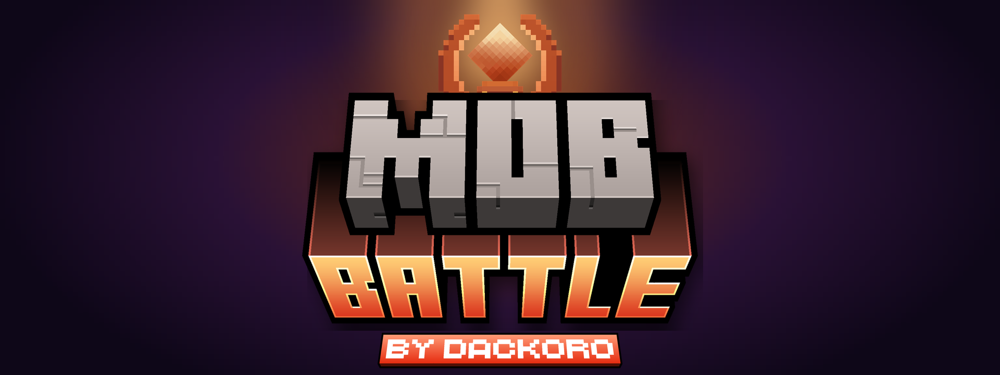
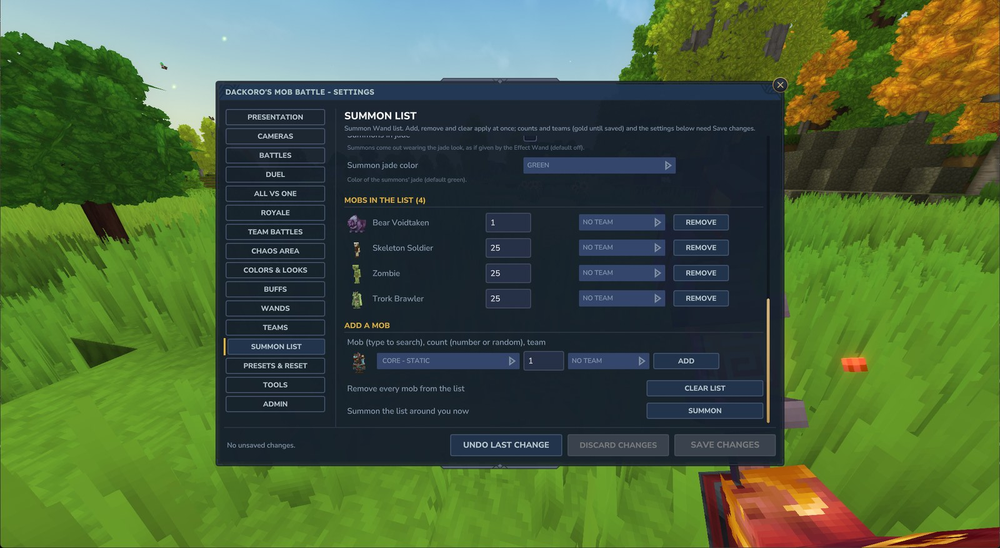
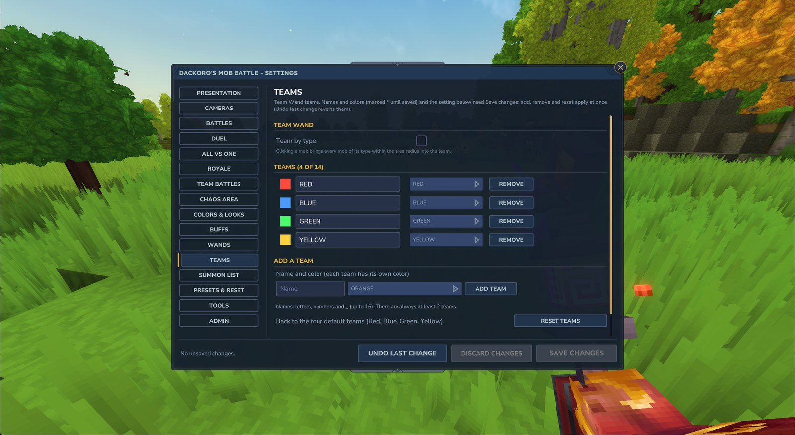

# Dackoro's Mob Battle

A Hytale mod by **Dackoro**: wands that make mobs fight using their existing AI. Supports vanilla NPCs and modded NPCs with compatible combat behavior; player-only attacks and encounter-specific mechanics may need adaptations.

Hytale **0.7.0** (release and the 0.7 pre-release: `ServerVersion >=0.7.0-pre <0.8.0`).

▶ **[Watch every wand in action](https://www.youtube.com/playlist?list=PLbSYS5J690io)** (YouTube playlist, one short clip per wand, battle kind and camera).

## Features at a glance

- **Four battle kinds:** duels, everyone vs one, battle royale and team battles, all driven by the mobs' own AI.
- **Thirteen wands** to start battles, summon mobs, build teams and armies, heal, kill, buff, morph, recolor and inspect mobs.
- **Players can fight too**, side by side with mobs or against them (never in Creative).
- **Arenas and timers:** walls that keep fighters in, closing royale zones, time limits with judging by health, damage or kills, scoreboards.
- **Presentation:** countdowns, big titles, intro and end cameras, battle music, a spectator mode to watch any fighter, duel and watch cards. ▶ [Duel cameras](https://youtu.be/eYbRIGjnRyw) · [royale cameras and spectator mode](https://youtu.be/urVVfprhp3o)
- **Looks:** Jade and Shimmer looks with their own death effects, crowns, buff shimmer, team tints and every color from a 14-color palette.
- **Settings panel** (`/mobbattle config`) with every setting, presets, resets and undo; settings are saved per world.
- **Server ready:** permission modes, console events and a public plugin API.

## Wands

Get all thirteen with `/mobbattle give` (admin), from the creative inventory, or with `/give <item ID>`. Each wand's tooltip explains what it does. Full details, sounds and quirks: [docs/wands.md](docs/wands.md).

`MobBattle_Wand` · ▶ Watch: [duel](https://youtu.be/TV-EqNu036Y) · [against a test dummy](https://youtu.be/NU3Tpd9qQdU) · [details](docs/wands.md#battle-wand-mobbattle_wand)

`MobBattle_ChaosWand` · ▶ Watch: [everyone vs one](https://youtu.be/VkftCvat9ng) · [battle royale](https://youtu.be/qorX35UQVe0) · [details](docs/wands.md#chaos-wand-mobbattle_chaoswand)

`MobBattle_TeamWand` · ▶ [Watch it](https://youtu.be/jvpsDgs0lXM) · [details](docs/wands.md#team-wand-mobbattle_teamwand)

`MobBattle_SummonWand` · ▶ Watch: [summon](https://youtu.be/M21iEYmvxqM) · [with a special look](https://youtu.be/Zg61ddWj5_w) · [details](docs/wands.md#summon-wand-mobbattle_summonwand)

`MobBattle_ArmyWand` · ▶ [Watch it](https://youtu.be/WdlFfEAAh0w) · [details](docs/wands.md#army-wand-mobbattle_armywand)

`MobBattle_MorphWand` · ▶ [Watch it](https://youtu.be/GG9UBmj5-o0) · [details](docs/wands.md#morph-wand-mobbattle_morphwand)

`MobBattle_HealWand` · ▶ [Watch it](https://youtu.be/vmuPqtAUbQk) · [details](docs/wands.md#heal-wand-mobbattle_healwand)

`MobBattle_KillWand` · ▶ [Watch it](https://youtu.be/1HrGRisZXxM) · [details](docs/wands.md#kill-wand-mobbattle_killwand)

`MobBattle_SnapWand` · ▶ [Watch it](https://youtu.be/ue_ffUmihbQ) · [details](docs/wands.md#snap-wand-mobbattle_snapwand)

`MobBattle_EffectWand` · ▶ [Watch it](https://youtu.be/-QTM87aRRRY) · [details](docs/wands.md#effect-wand-mobbattle_effectwand)

`MobBattle_CleanseWand` · ▶ [Watch it](https://youtu.be/5a5stZEjjEE) · [details](docs/wands.md#cleanse-wand-mobbattle_cleansewand)

`MobBattle_BuffWand` · ▶ [Watch it](https://youtu.be/69zD_VQW_-Q) · [details](docs/wands.md#buff-wand-mobbattle_buffwand)

**Debug Wand** (`MobBattle_DebugWand`, for mod makers, admin only): left click writes a full report on the mob, then follows it for a while; right click stops following. [Details](docs/wands.md#debug-wand-mobbattle_debugwand)

### Looks in every color

 

Jade and Shimmer looks, crowns, buff shimmer and team tints in any of the 14 palette colors. See [docs/colors-and-looks.md](docs/colors-and-looks.md).

## Install

1. Download `MobBattle.jar` from the releases.
2. Put it in your Hytale mods folder:
   - Release: `%APPDATA%\Hytale\UserData\Mods\`
   - Pre-release: `%APPDATA%\Hytale\data\pre-release\Mods\`
3. Enable **Mob Battle** in the world's Mods list.

Don't replace the jar while a world is open: Hytale keeps it locked and can't reload plugins on the fly. Exit to the main menu first.

## Quick start

1. `/mobbattle give` puts one of each wand in your inventory (needs `dackoro.mob_battle.admin`; otherwise take them from the creative inventory).
2. Hold the **Battle Wand**, left click one mob, then another: they fight. The winner gets a title.
3. Try the **Chaos Wand** right click near a group of mobs for a battle royale.
4. `/mobbattle config` opens the settings panel: countdowns, cameras, arenas, timers, colors and more. Nothing applies until **Save changes**.
5. `/mobbattle help` lists the commands by topic; `/mobbattle stop` ends every battle.

 

## Commands overview

Everything is under `/mobbattle`. Settings are saved per world in `fx.properties`. Any per-kind setting takes a battle kind (`duel`, `allVsOne`, `royale`, `teams`, `all`). The full reference, with every setting's key, values, default and reset group, is [docs/settings.md](docs/settings.md).

| Commands | What they cover |
|---|---|
| `help [topic]`, `settings`, `config` / `panel` | Help by topic, the current settings, and the settings panel. |
| `preset ...`, `reset <group>` | Built-in and saved presets; put one group of settings back to default. |
| `countdown`, `startTitle`, `winTitle`, `titleStyle`, `titleScope`, `music` | Countdown, titles and battle music (global or per kind). |
| `camera`, `cameraStyle`, `cameraTime`, `cameraShots`, `cameraScope`, `endCamera`, `endCameraTime`, `autoWatch`, `skipCamera` | Intro and end cameras. |
| `watch [exit]`, `duelCard` | Spectate a running battle; the duel stats card. |
| `battleIsolation`, `selfDefense`, `friendlyFire`, `playerFights`, `battlePvp`, `duelMode`, `chaos me` | Battle rules per kind, players in battles. |
| `arena`, `arenaSize`, `arenaShrink`, `timer`, `timeUp`, `judgeBy`, `tieBreak`, `scoreboard`, `timerStyle`, `unstick`, `standoffTime`, `passiveWin` | Arenas, timers, judging and stuck or passive fighters. |
| `areaRadius`, `areaStyle`, `areaColor`, `areaHeight`, `areaOnlyWand`, `maxMobs`, `fightLaser` | The Chaos Wand area and the fighter laser. |
| `teams ...`, `teamByType`, `teamLook` | Team list, Team Wand teams and team looks. |
| `summon ...`, `summonRadius`, `summonDespawn`, `summonJade`, `summonArmy`, `army clearAll`, `armyTint` | The summon list, summons leaving, armies. |
| `buff ...`, `buffColor`, `buffLight` | Battle buffs and the Buff Wand. |
| `wandFx`, `wandEffect`, `killDelay`, `killLoot`, `killPlayers`, `snap`, `snapRadius`, `morph ...`, `morphPlayers`, `healLight`, `cleanseColor` | Wand settings. |
| `wave`, `borderColor`, `mobFx`, `crown`, `lookGlow`, `deathGlow` | Colors and looks per action. |
| `stop`, `skipTimer`, `resetAll` | End battles and clean up (admin). |
| `permissions`, `reload`, `give`, `event ...`, `debug`, `debugLog`, `debugRecord`, `debugDump` | Server and debug tools. |

## Documentation

| Page | What it covers |
|---|---|
| [docs/wands.md](docs/wands.md) | Every wand: each click, what you see and hear, related settings and quirks. |
| [docs/battles.md](docs/battles.md) | Battle kinds, targeting, rules, arenas, timers, winners, titles, cameras, watching, music, players in battles. |
| [docs/teams-summon-army.md](docs/teams-summon-army.md) | Teams and team commands, the summon list and summons leaving, armies and their orders. |
| [docs/colors-and-looks.md](docs/colors-and-looks.md) | The palette, areas, shockwaves, marks, crowns, wand lights, team looks, Jade and Shimmer looks and death looks. |
| [docs/settings.md](docs/settings.md) | Full settings reference: commands, `fx.properties` keys, values, defaults, per-kind overrides, presets and reset groups. |
| [docs/settings-panel.md](docs/settings-panel.md) | The `/mobbattle config` panel: draft and save, undo, range previews, and every tab. |
| [docs/server-setup.md](docs/server-setup.md) | Permission modes and nodes, the settings file, admin and debug tools, console events. |
| [docs/plugin-api.md](docs/plugin-api.md) | `MobBattleApi` for other server plugins, with a compilable example. |
| [CONTRIBUTING.md](CONTRIBUTING.md) | Building from source, `deploy.ps1`, asset dev mode and hot reload, generator scripts, conventions. |

## Server owners

Mob Battle can stay open to everyone (default) or enforce `dackoro.mob_battle.use`, `config` and `admin` permissions with `/mobbattle permissions server`. Admins can also start ownerless NPC battles from the console (`/mobbattle event duel|royale|focus`). See [docs/server-setup.md](docs/server-setup.md).

## Plugin developers

Other server plugins can start and observe ownerless duel, royale and focus battles through `MobBattleApi`, which ships inside the Mob Battle jar. See [docs/plugin-api.md](docs/plugin-api.md).

## Building from source and contributing

JDK 25 and Gradle (wrapper included): `./gradlew build`. Building against your own Hytale install, `deploy.ps1`, asset hot reload and project conventions are in [CONTRIBUTING.md](CONTRIBUTING.md).

## Translations

To add a client language, copy `Server/Languages/en-US/server.lang` to `Server/Languages/<locale>/server.lang`, using the language code supported by the client (for example, `es-ES`). Translate only the values after `=`; keep every key, `\n` line break, command, and ID unchanged, and save the file as UTF-8. The current language files cover names and descriptions for the 13 wands, timer titles, and Watch controls. Many other messages are still raw English text in Java, including `MobBattleCommand`; translating those requires extracting translation keys with `Message.translation` and keeping the keys aligned across language files. The normal build includes `Server/**`, so no Gradle change is needed for a new language folder. Rebuild the normal package and check it in game with the client set to that language; support for an untested language or hot reload is not guaranteed.

## License

Open source under the [MIT License](LICENSE) © Dackoro. Use, copy, change and publish the code and the mod's own assets (models, textures, particles, effects, sounds, UI) in your own Hytale mods, servers and modpacks; just keep the copyright notice. A credit or a link back is appreciated, not required. Parts that come from Hytale's own game assets stay under Hytale's modding terms.
