# Wands

Dackoro's Mob Battle adds thirteen wands. Each one uses the mobs' own AI: the wands only tell mobs who to fight, change how they look, or help you set up and inspect battles. This page covers every wand: what each click does, what you see and hear, which settings change it, and the quirks worth knowing.

▶ Every clip in one place: [the Mob Battle playlist](https://www.youtube.com/playlist?list=PLbSYS5J690io).

Settings are named as chat commands (`/mobbattle <setting>`). They are all described in [settings.md](settings.md) and can also be changed in the settings panel ([settings-panel.md](settings-panel.md)). Battle kinds, countdowns, cameras and arenas are covered in [battles.md](battles.md). Teams, the summon list and armies are covered in [teams-summon-army.md](teams-summon-army.md). Colors and looks are covered in [colors-and-looks.md](colors-and-looks.md).

## Getting the wands

Each wand's tooltip explains what it does, in English and Spanish.

- `/mobbattle give` gives you one of each wand, placed in your inventory the normal way. If some don't fit, the chat lists the ones you didn't get. It needs the `dackoro.mob_battle.admin` permission. The **Admin** page of the settings panel has the same button.
- Every wand is also in the creative inventory (Weapons), and you can get one with `/give <item ID>`.
- In `server` permission mode, using a wand needs `dackoro.mob_battle.use`. Two clicks change shared settings instead, so they need `dackoro.mob_battle.config`: the Effect Wand right click and the Summon Wand left click. The Debug Wand needs `dackoro.mob_battle.admin` in both modes. See [server-setup.md](server-setup.md).

## At a glance

| Item ID | Name | Quality | Left click | Right click | Players |
|---|---|---|---|---|---|
| `MobBattle_Wand` | Battle Wand | Legendary | Pick mob A, then mob B: they duel | Clear the selection, or cancel a duel countdown | Yes, with `playerFights duel` |
| `MobBattle_ChaosWand` | Chaos Wand | Epic | Everyone vs one: every mob around attacks the clicked one | Battle royale around the mob you aim at, or around you | Yes, with `playerFights allVsOne` / `royale` |
| `MobBattle_TeamWand` | Team Wand | Rare | Add or remove a mob in the current team | In the air: next team. On a mob: start the team battle | Yes, with `playerFights teams` |
| `MobBattle_SummonWand` | Summon Wand | Uncommon | Add or remove the mob's type in the summon list | Summon the whole list around you | No |
| `MobBattle_ArmyWand` | Army Wand | Rare | Add or remove a mob in your army | Disband your army | No |
| `MobBattle_MorphWand` | Morph Wand | Uncommon | Give the mob the copied model | Copy a model (in the air: show the copied one) | Yes, with `morphPlayers` |
| `MobBattle_HealWand` | Heal Wand | Uncommon | Back to full health | None | Yes |
| `MobBattle_KillWand` | Kill Wand | Epic | Kill it (soul rip, then removal) | None | Yes, with `killPlayers` |
| `MobBattle_SnapWand` | Snap Wand | Legendary | Half of the fighters turn to dust | None | Yes, with `snapPlayers` |
| `MobBattle_EffectWand` | Effect Wand | Legendary | Give the selected effect | Next effect in the list | Yes |
| `MobBattle_CleanseWand` | Cleanse Wand | Common | Remove every effect and buff, undo a morph | None | Yes |
| `MobBattle_BuffWand` | Buff Wand | Epic | One more buff stack | Take the wand's buff off | Yes |
| `MobBattle_DebugWand` | Debug Wand | Common | Full report on the mob, then follow it | Stop following | Meant for mobs |

The `playerFights`, `morphPlayers`, `killPlayers` and `snapPlayers` settings are all **on** by default. Players in Creative are never put into a battle.

## How every wand behaves

- **Swings:** wands swing like a sword and alternate left and right on quick clicks. Each swing finishes before the next one starts. Some wands have their own cast: the Kill Wand channels, the Snap Wand and the Chaos Wand right click slam the ground, and the Summon Wand raises a staff.
- **Clicking the air** never breaks the swing. If the wand needs a target, the chat tells you what to aim at.
- **Feedback on the mob** (tints, bursts, auras, sounds) only plays when the action works. [`/mobbattle wandFx off`](settings.md) turns all of it off. The cast animations still play.
- **Errors** show as a short red flash with a fizzle and an error sound on the mob, plus a chat message. Examples: the Battle Wand on two mobs that can't fight, the Morph Wand with no copied model, or the Buff Wand at its max.
- **One wand tint at a time:** a new wand tint replaces the previous one on that mob, so two colors never mix into a washed-out white. Effects without a tint (Effect Wand, unmorph) play on top. The Kill Wand soul rip and team looks are never replaced.
- **Clicking the same mob again** restarts its effect from the beginning instead of just extending it.

---

## Battle Wand (`MobBattle_Wand`)

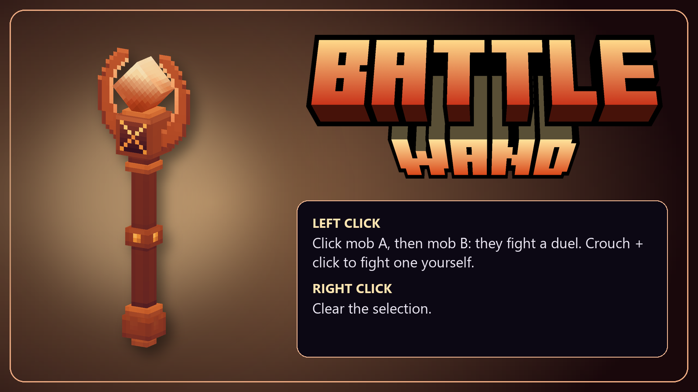

▶ Watch: [duel](https://youtu.be/TV-EqNu036Y) · [against a test dummy](https://youtu.be/NU3Tpd9qQdU)

Makes two mobs fight each other in a duel.

**Left click**
1. Click mob A. It is selected and gets a short purple charm (purple tint, burst ring and aura; it isn't stunned). The chat says to click its opponent.
2. Click mob B. It gets the same charm (or the color set with `mobFx duel`), and the duel starts. If a countdown, intro camera, arena or timer is set for duels, those come first. See [battles.md](battles.md).
3. Clicking the selected mob again deselects it, with a grey flash.

**Right click:** clears your selection with a grey flash on the selected mob. During a duel's countdown, it cancels that duel and its intro camera.

**With players** (`playerFights duel on`, the default):
- You can pick other players just like mobs.
- **Crouch + click a mob** to make that mob fight you.
- **Select a mob, then crouch + click the air** to make it fight you. You also slam the ground: the Snap Wand's slam animation plus a purple shockwave about 8 blocks wide. The shockwave is only for show. Its colors are [`/mobbattle wave slam`](settings.md) and [`/mobbattle borderColor slam`](settings.md).

**Sound:** a spellbook impact on each left click.

**Gotchas**
- If neither mob can attack (two passive mobs), nothing starts. Both mobs flash red and the chat says why.
- A passive mob in a duel only runs away. The chat warns you when that happens.
- [`/mobbattle duelMode`](settings.md) `exclusive` (the default) replaces a mob's previous duel. `accumulate` merges connected duels into one.
- The duel mark is set with [`/mobbattle mobFx duel`](settings.md). The default is the purple charm.

**Related settings:** `duelMode`, `playerFights`, `mobFx`, and every per-kind battle setting for `duel`: countdown, camera, arena, timer and others.

## Chaos Wand (`MobBattle_ChaosWand`)

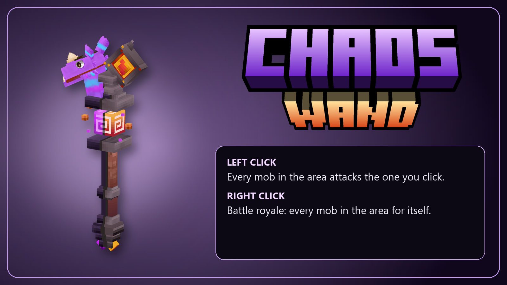

▶ Watch: [everyone vs one](https://youtu.be/VkftCvat9ng) · [battle royale](https://youtu.be/qorX35UQVe0)

Starts group battles among every mob within [`/mobbattle areaRadius`](settings.md) (default 60 blocks), capped at the [`/mobbattle maxMobs`](settings.md) nearest mobs (default 200). The chat tells you how many mobs were left out.

**Left click: everyone vs one.** Aim at a living mob, or at a player with `playerFights allVsOne on`.
1. The area is drawn (see [colors-and-looks.md](colors-and-looks.md#areas)) and a yellow shockwave runs out to its edge with a snap sound.
2. The lone target glows gold and every attacker glows red, each with a small rune turning under its feet. A big rune lights up at the area center for the countdown, with a portal-opening sound (the game's `SFX_Portal_Neutral_Open`, for both clicks; `wandFx off` mutes it).
3. When the fight starts, everyone attacks the target, and the target fights back against the nearest attacker. It wears a golden crown for 20 s ([`/mobbattle crown`](settings.md)).
4. If there is a lone buff ([`/mobbattle buff lone`](settings.md)), the target gets it as the countdown starts, so it is already big and healthy when the first hits land.

**Right click: battle royale.** Centered on the mob you aim at, or on you.
1. A spellbook charge with a ground slam and a light camera shake. The purple shockwave and snap sound go off when the slam lands ([`/mobbattle snapHitDelay`](settings.md)).
2. Every fighter gets the royale mark, with the same runes. The mark is purple by default; `mobFx royale default` gives the original orange glow.
3. Each fighter starts on one of its 3 nearest opponents, picked at random. When its target dies, it goes for the nearest survivor. The last one standing wins.
4. With `playerFights royale on`, the players in the area fight too.

**Gotchas**
- With no mobs in range (or fewer than 2 for a royale), you only get the cast and a chat message: no area and no effects.
- A new everyone-vs-one or royale order pulls those mobs out of whatever battle they were in.
- The fighters' marks and runes follow [`/mobbattle runes`](settings.md). With runes off, the `mobFx` marks of these two battles don't show either.
- The left click cast plays a fire-wand shot.

**Related settings:** `areaRadius`, `maxMobs`, `areaStyle`, `areaColor`, `areaHeight`, `areaOnlyWand`, `wave allVsOne|royale`, `borderColor allVsOne|royale`, `mobFx allVsOne|attackers|royale`, `crown`, `runes`, `buff lone`, `playerFights`, and the per-kind battle settings for `allVsOne` and `royale`.

## Team Wand (`MobBattle_TeamWand`)

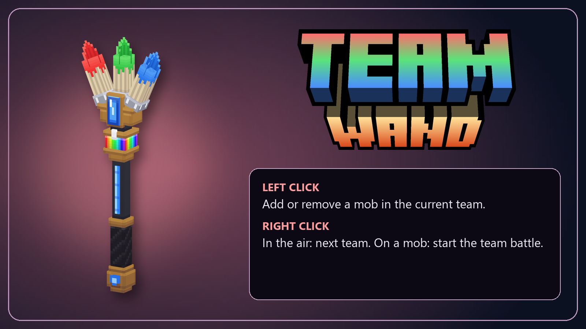

▶ [Watch it](https://youtu.be/jvpsDgs0lXM)

Builds teams and starts a team battle. The last team standing wins. Full details are in [teams-summon-army.md](teams-summon-army.md).

**Left click a mob:** adds it to your current team, with a swirl in the team color and the team look. Click it again to take it out. With `playerFights teams on`, players can be added the same way. With [`/mobbattle teamByType on`](settings.md), every mob of the same type within `areaRadius` follows the clicked one into (or out of) the team.

**Right click in the air:** switches to the next team. **Right click a mob:** starts the battle. It needs at least 2 teams with living members.

**While you hold the wand**, each team's mobs show a ring in the team color at their feet. Only you can see these rings.

**Sound:** a spellbook impact on each left click.

**Related settings:** `teams ...`, `teamLook`, `teamByType`, `playerFights teams`, and the per-kind battle settings for `teams`.

## Summon Wand (`MobBattle_SummonWand`)

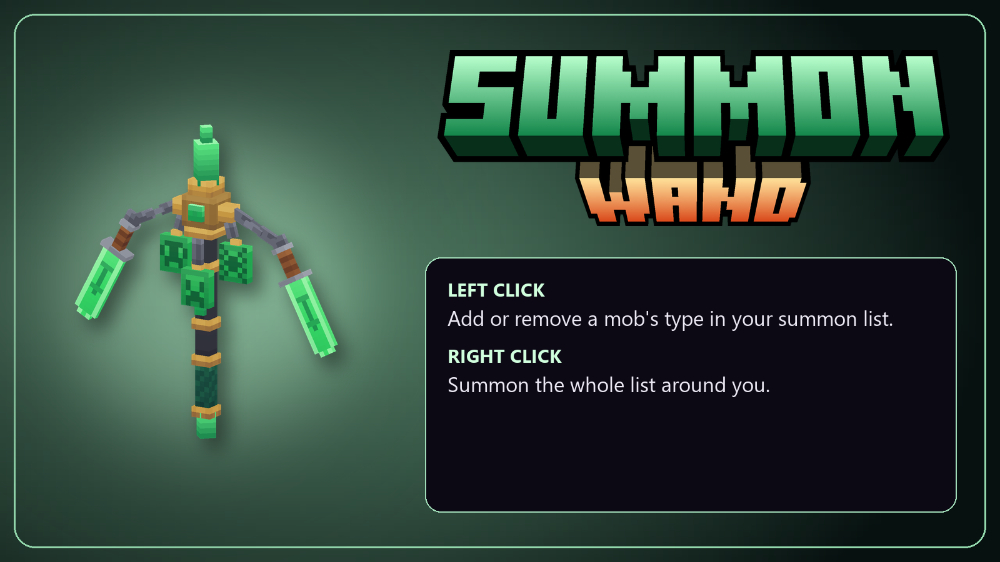

▶ Watch: [summon](https://youtu.be/M21iEYmvxqM) · [with a special look](https://youtu.be/Zg61ddWj5_w)

Spawns a saved list of mobs to set up battles quickly. Full details are in [teams-summon-army.md](teams-summon-army.md).

**Left click a mob:** adds its type to the summon list (1 of it), with a green flash. Click again to remove it, with a red flash. The list is a saved setting shared by everyone, so in `server` mode this click needs `config`.

**Right click:** summons the whole list around you, up to `maxMobs`.
- Mobs appear on the floor close around you (also under roofs). Each one rises from a rune with a summon burst and its model's own spawn animation, if it has one (for example, skeletons climbing out of the ground).
- The summon area is drawn for 3 s, with a green shockwave.
- Big summons spawn over a few ticks so the server doesn't stall.

**Gotchas**
- Mobs with a team rule ([`/mobbattle summon team`](settings.md)) spawn already in their team.
- [`/mobbattle summonJade`](settings.md) makes summons come out wearing the jade look. [`/mobbattle summonArmy`](settings.md) puts them in your army. [`/mobbattle summonDespawn`](settings.md) / `summonLifetime` / `summonExit` make them leave by themselves.

**Related settings:** `summon ...`, `summonRadius`, `maxMobs`, `wave summon`, `borderColor summon`, `summonJade`, `summonJadeColor`, `summonArmy`, `summonDespawn`, `summonLifetime`, `summonExit`.

## Army Wand (`MobBattle_ArmyWand`)

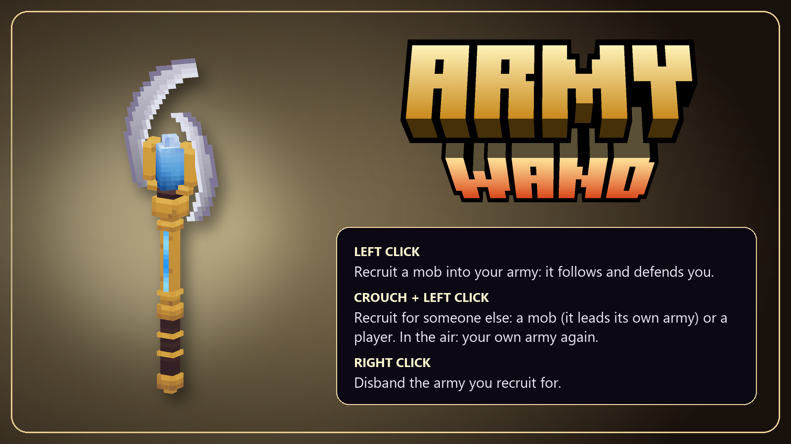

▶ [Watch it](https://youtu.be/WdlFfEAAh0w)

Builds your own army of mobs. Full details are in [teams-summon-army.md](teams-summon-army.md).

**Left click a living mob:** it joins your army, with a blue flash and a blue burst ring. Click it again and it leaves, with a red flash.

**Right click (anywhere):** disbands your whole army. Every member flashes red and goes back to its own AI.

**What the army does:** it follows you, defends itself and you, and attacks whatever you hit or whatever hits you, including players. Army mobs never hurt you or each other. Mobs that fall more than 20 blocks behind are teleported back around you.

**While you hold the wand**, each army mob shows a blue ring at its feet. Only you can see it.

**Gotchas**
- Joining an army takes the mob out of any battle, duel or team.
- Armies are kept in memory only, so they are gone after a server restart.
- [`/mobbattle armyTint`](settings.md) makes army mobs wear a tint ([`/mobbattle armyTintColor`](settings.md), default blue) for as long as they are in the army.

## Morph Wand (`MobBattle_MorphWand`)

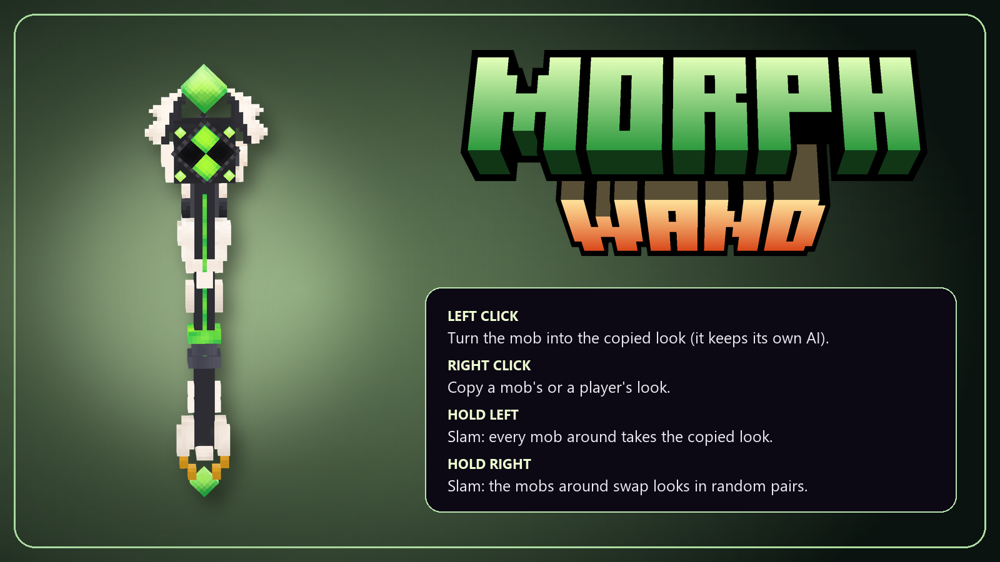

▶ [Watch it](https://youtu.be/GG9UBmj5-o0)

Gives a mob another mob's model. It keeps its own AI, weapon, attacks and health. It works like the game's frog potion, but has no time limit.

**Right click a mob or player:** copies its model (and its scale). The mob flashes green, a "recalibrated" Omnitrix sound plays at it, and the chat names the model. **Right click the air** to see which model you have copied.

**Left click a mob:** puts the copied model on it, with a green flash, a green burst and the Omnitrix transform sound. With [`/mobbattle morphPlayers on`](settings.md) (the default), players can be morphed too.

**Hold left click (1.5 s, with a charge bar), then let go:** a green shockwave from you gives every mob within [`morphBurstRadius`](settings.md) (default 12 blocks) your copied model. Players in reach are morphed too with `morphPlayers on`, never you. Turn it off with `/mobbattle morphBurst off`, and a held left click then works like a quick one.

**Hold right click (1.5 s), then let go:** the same shockwave, but the mobs in reach **swap models with each other** in random pairs. With an odd number, the last three trade in a ring. Turn it off with `/mobbattle morphShuffle off`.

**Switching to the wand** in your hotbar plays the Omnitrix power-on sound.

**Sounds:** `SFX_MobBattle_OmnitrixOn` (switching to the wand, at you), `SFX_MobBattle_OmnitrixCopy` (at the mob whose model you copy) and `SFX_MobBattle_OmnitrixTransform` (at the mob as it transforms), each with a small random pitch and skipped with `wandFx off`. The transform burst also plays in the world at the mob, since the model swap can drop particles attached to the old model.

**Other ways to pick a model:** [`/mobbattle morph <model>`](settings.md) (for example `Frog_Green`). `/mobbattle morph list [text]` searches model IDs (first 40 matches), and the Wands page of the settings panel has a searchable list with icons.

**Undo:** the Cleanse Wand, or `/mobbattle morph reset`. `morph reset` gives the loaded morphed mobs in your current world or instance their own model back; originals remembered in other instances stay available for when you return there.

**Gotchas**
- Your copied model is yours alone and is kept only while the server runs.
- A morph is **saved with the world**, but the original model is only remembered while the server runs. Undo morphs before you leave, or the mob keeps its new look.
- Applying the model a mob already has does nothing (error flash and a chat message). So does left click with nothing copied yet.
- The new model's animations may not match the old role's attacks.
- Quick clicks now fire when you let go of the button, as with the game's staffs, since the wand waits to see whether you are charging.
- Jade/shimmer looks, buff looks and crowns are put back on after the model swap.

## Heal Wand (`MobBattle_HealWand`)

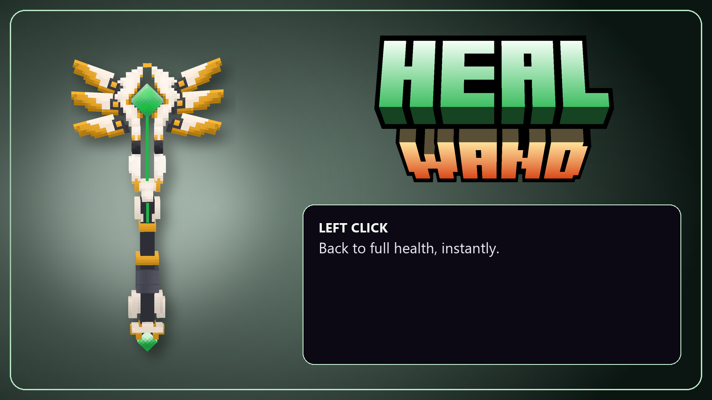

▶ [Watch it](https://youtu.be/vmuPqtAUbQk)

**Left click any mob or player:** brings it back to full health.

**Step by step**
1. A light comes down from the sky onto the target, sized to its height, in [`/mobbattle healLight`](settings.md) (default green).
2. When the light lands, about 0.4 s later, the target is healed to 100%. It gets a green glow and burst, the Healing Totem fireflies and the healing sound.

With `healLight off` or `wandFx off` there is no light, and the heal lands at once.

**Gotchas**
- It only restores health. Effects, buffs and morphs stay.
- A mob with a health buff is healed to its raised max.

## Kill Wand (`MobBattle_KillWand`)

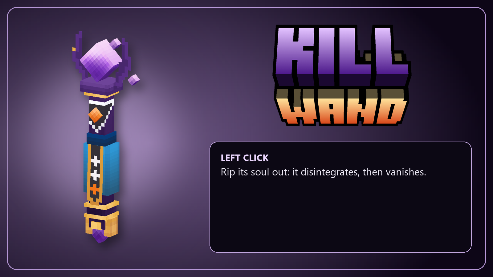

▶ [Watch it](https://youtu.be/1HrGRisZXxM)

**Left click:** kills the target, whatever its health.

**Step by step (a mob, default settings)**
1. You channel with the wand. The hit lands [`/mobbattle killHitDelay`](settings.md) after the click (default 175 ms, matching the cast animation; `0` = on the click; skipped with `wandFx off`). The hakai sound, the disintegration and `killDelay` all start at the hit.
2. A "hakai" sound (`SFX_MobBattle_Hakai`) plays from you, with a random pitch so it never sounds the same, also on instant kills. The mob plays its own death sound at the start, or a random dark one if its model has none; it doesn't repeat on removal.
3. The mob keeps moving, animating and attacking (the disintegration doesn't block its damage) while it turns black and disintegrates from the middle out. A small purple soul smoke spirals from it and shrinks toward your wand tip, and it gives off a flash of purple light that fades out ([`/mobbattle deathGlow`](settings.md), default 12). The wand tip position is approximated from your position and look direction, not the animated hand bone, so custom models may need offset adjustments.
4. After [`/mobbattle killDelay`](settings.md) (default 0.5 s), the mob is removed. There is no death animation and no corpse.

**Death looks:** a mob wearing a **jade** look shatters into jade shards instead. A mob wearing a **shimmer** look (including the buff's shimmer) turns its color from the feet up and bursts into liquid. Both happen in the look's color, and the light flash is in that color too. These take a bit longer than the soul rip (about 0.9 s), so the removal waits for them. See [colors-and-looks.md](colors-and-looks.md#jade-and-shimmer-looks).

**Loot:** by default, a mob killed this way drops **nothing**, also when it dies at once (`killDelay 0` or `wandFx off`). [`/mobbattle killLoot on`](settings.md) makes it drop what a normal death would: its drop list plus any items it picked up.

**Players:** with [`/mobbattle killPlayers on`](settings.md) (the default), players turn black and disintegrate too, and then die a normal death after `killDelay`. What they drop follows the world's death rules. With it off, the wand shows its error flash on players and says so in chat. It works whether the world has PvP on or off. A player in Creative, invulnerable (`/entity invulnerable`) or under spawn protection right after respawning can't die, so the wand shows its error flash and says so instead of the soul rip.

**Other entities** that have health die at once.

**Gotchas**
- `killDelay 0` or `wandFx off` kills at once, with no soul rip and no death look.
- A disintegration is not a kill for battle kill counts.

## Snap Wand (`MobBattle_SnapWand`)

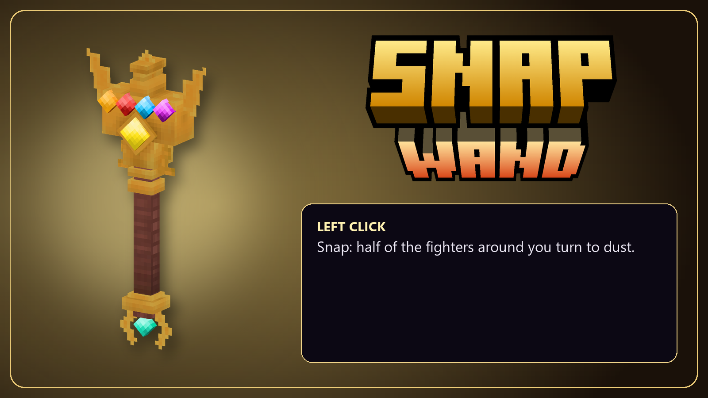

▶ [Watch it](https://youtu.be/ue_ffUmihbQ)

**Left click:** half of the fighters, picked at random, turn to dust.

**Who is affected**
- **Click a mob that is in a battle:** that battle's fighters, wherever they are.
- **Click the air, or a mob in no battle:** every mob within [`/mobbattle snapRadius`](settings.md) (default 60) of the clicked mob or of you, fighting or not. This counts at any height, so fliers above and mobs in caves below are included, up to `maxMobs`. A white shockwave on the ground shows how far it reached. Players in reach are taken too with [`/mobbattle snapPlayers on`](settings.md) (the default), but never you and never players in Creative or invulnerable.

**Step by step**
1. You slam the ground. The snap fires when the slam lands ([`/mobbattle snapHitDelay`](settings.md), default 310 ms) with the snap sound, even if nobody is picked.
2. [`/mobbattle snapPercent`](settings.md) (default 50%) of them are picked at random. An odd count rounds up or down at random. With [`/mobbattle snapMode team`](settings.md), it takes half of **each side** instead of half of everyone.
3. Over the next [`/mobbattle snapTime`](settings.md) seconds (default 5), each one crumbles to ash at a random moment, with a fading sound. An ash cloud drifts away on the wind, and then the mob is removed.
4. The chat says how many were picked ("Snap! 12 of 24 within 60 blocks will turn to dust...", or "in that battle" when you clicked a mob in one), and again when the snap is over.

**Sounds:** `SFX_MobBattle_Snap` plays from you when the snap fires, and `SFX_MobBattle_SnapFade` at each mob or player as it fades to dust. Both have a random pitch and are skipped with `wandFx off`.

**Death looks:** jade and shimmer mobs shatter or burst in their color instead of turning to ash. There is no ash cloud and no light flash.

**Gotchas**
- `killLoot` also decides whether snapped mobs drop loot (default: no).
- Snapped players crumble and then die a normal death.
- With `wandFx off`, the snap fires on the click (no slam to wait for), and each picked mob simply dies when its turn comes, without the ash.
- `/mobbattle snap` does the same as clicking the air. Snap disintegrations don't count as kills.
- `snapRadius` is its own value, separate from `areaRadius`: a big battle area does not make the snap reach farther.
- If the snap lands before or after the slam's hit, retune [`/mobbattle snapHitDelay`](settings.md#wands).

## Effect Wand (`MobBattle_EffectWand`)

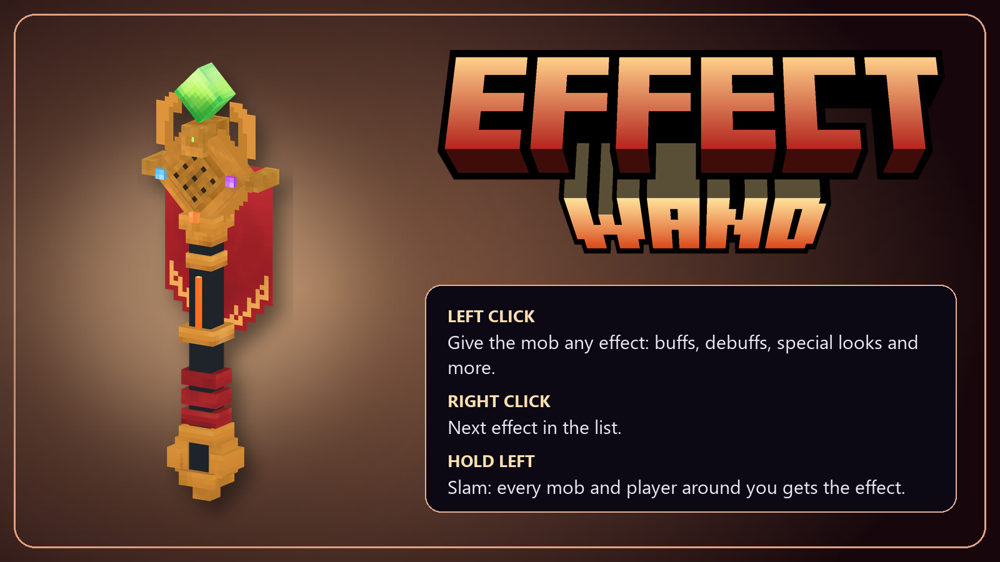

▶ [Watch it](https://youtu.be/-QTM87aRRRY)

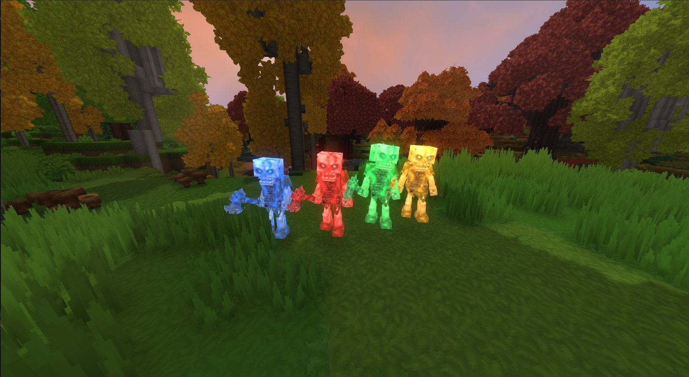
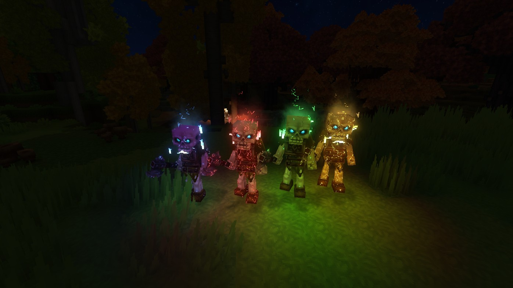

**Left click any mob or player:** gives it the selected effect (default `Burn`), with a purple burst. The chat says if the target rejected it (immune, or the effect doesn't apply).

**Right click:** switches to the next effect in the quick list: `Burn`, `Poison_T2`, `Freeze`, `Slow`, `Stun`, `Root`, `Vulnerable`, `Ability_Enrage_Buff`, `Potion_Health_Regen`, `Immune`, `jade`, `shimmer`.

**Any other effect:** [`/mobbattle wandEffect <id>`](settings.md) accepts any loaded effect ID, including other mods' (for example `Potion_Morph_Frog`). It also accepts:
- A chain `A>B>C`: each effect is given when the previous one ends (0.5 s after an infinite one).
- `jade` or `jade:<color>`: the mob turns to jade with glowing eyes. It grows into it over about 1 s, then holds it. The default color is green.
- `shimmer` or `shimmer:<color>`: glowing veins under the skin, flames in the eyes, and runes over the head. The default color is purple.

Any palette color works (`jade:red`, `shimmer:blue`...). `gold` means yellow, and black is very faint. See [colors-and-looks.md](colors-and-looks.md#jade-and-shimmer-looks).

**Gotchas**
- **The selected effect is a shared, saved setting**, not per player. That is why the right click needs `config` in `server` mode.
- Jade and shimmer looks (any effect whose ID starts with `MobBattle_` and contains `Jade` or `Shimmer`) last until the Cleanse Wand or death. They are kept visible: the game would otherwise hide them whenever the mob loses another effect, so the mod puts them back on. They also glow with [`/mobbattle lookGlow`](settings.md).
- Giving a new look to a mob that already has one replaces the old look.
- A buffed mob that gets a jade or shimmer look keeps that look. Its buff shows only as runes and eye flames.

## Cleanse Wand (`MobBattle_CleanseWand`)

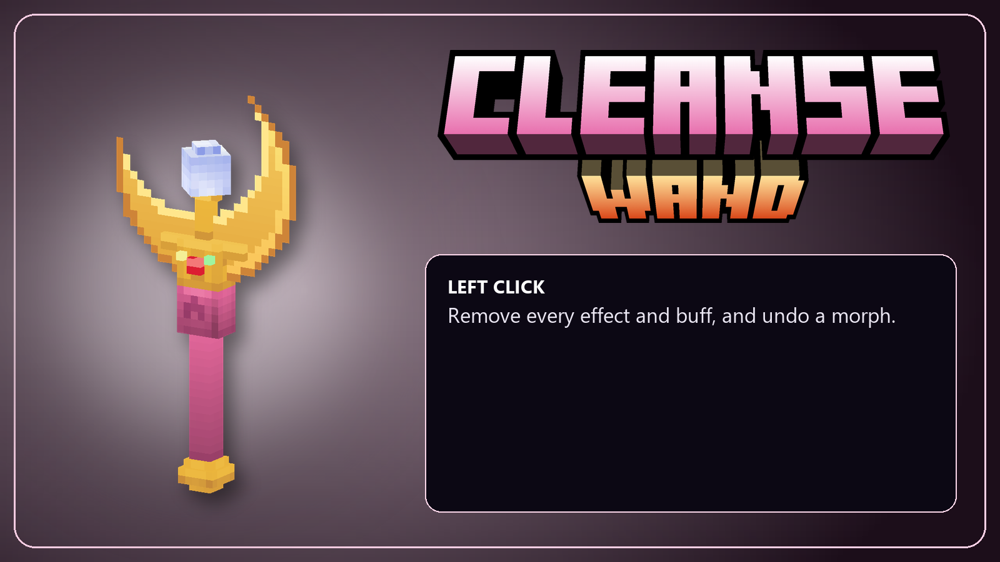

▶ [Watch it](https://youtu.be/5a5stZEjjEE)

**Left click any mob or player:** removes every effect and every buff, and undoes a morph.

**Step by step**
1. A light comes down from above, the crown's rays without the crown, sized to the target's height. It comes with a burst, an aura, a rune at its feet and the healing totem's fade sound, all in [`/mobbattle cleanseColor`](settings.md) (default white).
2. When the light lands, about 0.4 s later:
   - every buff goes, so size and max health are back to normal and any buff crown disappears;
   - every effect goes, including jade and shimmer looks, team looks, potions and debuffs;
   - a morph is undone, with a green burst and a portal sound as the mob gets its model back.

**Hold left click (1.5 s, with a charge bar), then let go:** a shockwave in the cleanse color goes out from you, and every mob and player within [`cleanseRadius`](settings.md) (default 12 blocks) is cleansed as above, never you. The sound plays once at you. Turn it off with `/mobbattle cleanseArea off`, and a held left click then works like a quick one.

**Gotchas**
- Quick clicks fire when you let go of the button, as with the game's staffs, since the wand waits to see whether you are charging.
- It is the way to undo Buff Wand stacks, champion buffs, Effect Wand looks and morphs on a single mob.
- An army tint comes back within a second, because it lasts as long as the mob is in an army.

## Buff Wand (`MobBattle_BuffWand`)

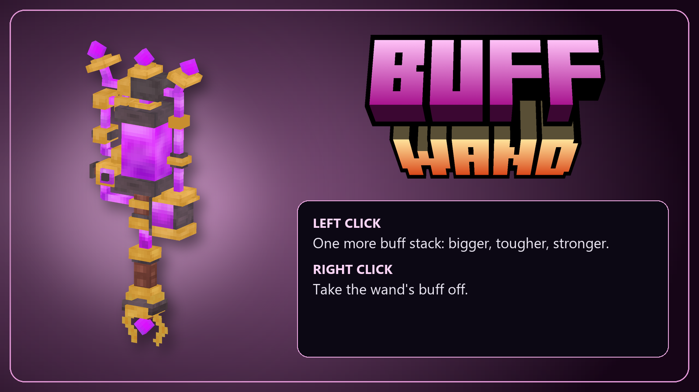

▶ [Watch it](https://youtu.be/69zD_VQW_-Q)

**Left click a mob or player:** adds one more buff stack.

**Step by step**
1. On the click, a swirl in [`/mobbattle buffColor`](settings.md) (default purple) shows that the click was taken. A light comes down from the sky onto the target ([`/mobbattle buffLight`](settings.md), in `buffColor` by default).
2. When the light lands, about 0.4 s later, the stack lands with a mark in the buff color: tint, burst, aura and rune at its feet. The mob grows, and its max health goes up.
3. The chat shows the stacks and totals, for example `Buffed Skeleton: 2/5 stacks (size +20%, health +40%, damage +20%, defense +10%)`.

With `buffLight off` or `wandFx off`, everything lands at once.

**Per stack**, by default: size +10%, health +20%, damage +10%, defense +5% ([`/mobbattle buff wand`](settings.md)). Stacks go up to [`/mobbattle buff wand maxStacks`](settings.md) (default 5, max 50). Each stat is capped (size at [`buff sizeMax`](settings.md), default 200% = x3; health 1000%, damage 1000%, defense 90%). A bigger mob or player also jumps higher.

**While the buff lasts**, the mob wears the shimmer in `buffColor`: glowing veins, eye flames and runes over its head. A mob with a jade or shimmer look of its own keeps that look and only gets the runes and eye flames. With [`/mobbattle buff crown`](settings.md) (default off), it also wears a crown.

**Right click:** takes the wand's buff off, including stacks still coming down. The mob flashes grey with a grey swirl and a purple liquid splash, and it shrinks back. Buffs from battles (streak, champion, lone) stay.

**Gotchas**
- At the max, a click shows the error flash and says so in chat. Quick clicks can't go past the max, because stacks still falling count.
- The wand's damage and defense count against **anyone**, inside and outside battles.
- The buff lasts until the mob dies or gets the Cleanse Wand. A buffed mob that dies (Kill Wand, Snap or any other death) turns the buff color and bursts.
- Health goes up as a share of the max, so a full mob stays full. Use [`/mobbattle buff wand heal on`](settings.md) to fill it to the new max on each stack.
- If all the wand percents are 0, the wand says it is off.
- Size and max health are saved with the world. If the server stops, a buffed mob stays big after the restart. Use the Cleanse Wand to reset it.

## Debug Wand (`MobBattle_DebugWand`)

A read-only tool for checking what a mob is doing. Admins only (a real `dackoro.mob_battle.admin` grant, in both permission modes), since every click writes a file and the whole report to the server log.

**Left click a mob:** writes a full report about it. The report covers identity and role, model, stats, effects, its battle and side, buffs and its AI state. It goes to three places:
- a short summary in chat (health, effects, battle, buffs);
- the whole report in the server log;
- a file `debug/<role>_<time>.txt` in the plugin data folder.

**Then it follows the mob** for [`/mobbattle debugTrack`](settings.md) seconds (default 30; `0` = report only). Once a second, it notes changes to the mob's target, AI state, health and effects. It also logs every hit the mob gives or takes (who, how much, the damage cause, and whether it ended up cancelled), and every 5 s where the mob is and how far away its target is. All of this is added to the **same** report file, the server log and chat.

**Right click:** stops following. A new left click replaces the mob being followed (one per player).

**Related:** `/mobbattle debug` (snapshots of the 4 nearest NPCs), `/mobbattle debugLog`, `/mobbattle debugRecord` and `/mobbattle debugDump` (admin). See [settings.md](settings.md).
